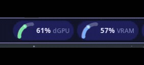
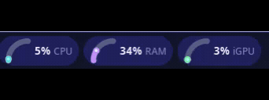

# TachoPulse (`broli/tachopulse`)

**Modular Hardware & Storage Telemetry Widget for Noctalia v5 (`plugin_api = 32`)**

TachoPulse provides modular, real-time hardware telemetry for the **Noctalia Status Bar** (`[[widget]]`) and **Desktop Wallpaper** (`[[desktop_widget]]`). It pairs a dynamic Linux sensor discovery engine with anti-aliased rendered gauges (Automotive Tachometer, Corner Quarter-Tachometer, Vertical Capsule Bar, and Geometric Radiating Arcs).

<div align="center">

 &nbsp; 

</div>

---

## The Core Concept: Independent Named Widgets

Rather than bundling every hardware metric into a single monolithic, cluttered widget, **TachoPulse is designed for users to add multiple named widgets to their Noctalia bar and desktop, each configured completely separately**.

- **Add Multiple Discrete Widgets**: Place as many independent widgets as desired anywhere across your bar order (`cpu_tach`, `gpu_temp`, `disk_free`, `wifi_net`).
- **Separate Instance Profiles**: Each widget entry points to its own `instance_id` (e.g. `instance_id = "default"`, `instance_id = "cpu_temp"`, `instance_id = "storage_free"`).
- **Independent Visuals & Sensor Bindings**: Configure one widget as a compact cyan quarter-tachometer for CPU load, another as an orange speedometer with a 🔥 emoji for GPU temperature, a third as a green vertical capsule bar for root drive free space, and a fourth as radiating WiFi signal arcs.
- **Dedicated 1-Click Studio**: Clicking any widget instance in your status bar or on your desktop opens TachoPulse Studio pre-focused on that specific widget's profile, allowing live sensor selection and visual tuning with immediate feedback.

---

## Features

- **4 Modular Face Elements (Freely Toggle Any Combination)**:
  1. **Icon**: Tabler Nerd glyph (e.g. `cpu`, `flame`, `database`, `car-fan`, `wifi`) or custom Emoji / Unicode (e.g. 💾, 🔥, ⚡, 📶, 🚀).
  2. **Graphic Gauge**:
     - **Full Tachometer**: ~330° automotive gauge with background track, active arc, and needle bead.
     - **Quarter Tachometer**: 90° corner arc maximizing horizontal space for bar text.
     - **Vertical Bar**: Linear capsule filling from bottom to top.
     - **Geometric Arcs / Bars**: Concentric radiating WiFi arcs or stepped cellular signal bars.
  3. **Live Value**: Formatted live number with contextual unit (`%`, `°C`, `GB`, `RPM`, `MB/s`, `W`) and custom decimal precision (0, 1, or 2 decimals).
  4. **Label**: Freeform user text (e.g. `"CPU"`, `"RTX 4070"`, `"/home"`, `"Fan 1"`).

- **Linux Telemetry Discovery Engine (KDE ksystemstats Inspired)**:
  - **Storage & Filesystems (`statvfs` & `/proc/mounts`)**: Physical mount points (`/`, `/home`, secondary drives) reporting Free Space (GB/TB), Used Space (GB/TB), Free %, and Used %.
  - **Multi-GPU (`nvtop -s` + DRM sysfs)**: Discrete NVIDIA and integrated AMD/Intel GPUs with per-GPU load %, VRAM usage, temperatures, and power draw.
  - **CPU (`/proc/stat` + `cpufreq`)**: Total load, package temperature (Tctl), average/max clock frequencies, load averages, and per-core threads (`cpu0`..`cpuN`).
  - **Motherboard & Chipset (`hwmon`)**: Temperature probes, fan RPMs, voltages, and thermal zones.
  - **Memory & Swap**: Physical RAM used/available, swap utilization.
  - **Network (`/proc/net/dev`)**: Real-time download/upload transfer rates.
  - **Battery & Linux PSI**: Charge %, charging status, power draw, and CPU/memory/IO stall pressure.

- **Interactive Configuration Studio & Sensor Picker (`panel.luau`)**:
  Click any status bar widget or desktop card to open the Studio:
  - **Modular Element Toggles**: Toggle any combination of the four face elements on/off.
  - **Native Dropdowns (`ui.select`)**: Vibrant color palette presets (Cyan, Blue, Green, Orange, Purple, Red, Yellow), graph styles, stroke widths, and precision.
  - **KDE-Style Sensor Picker**: Filterable search bar (matches sensor name, category, sensor ID, and short label), category tabs, and live fluctuating readings with 1-click binding.

---

## Dependencies

- **Required**:
  - `noctalia` (`>= 5.3.0`, `plugin_api = 32`)
  - `python3` + `python-pillow` (`PIL` for anti-aliased graph rendering)
- **Recommended (for Multi-GPU NVIDIA / AMD / Intel Telemetry)**:
  - `nvtop` (used via `nvtop -s` for JSON multi-GPU telemetry; falls back to DRM sysfs if not installed)

Installation by distribution:
```bash
# Arch Linux / CachyOS
sudo pacman -S python python-pillow nvtop

# Debian / Ubuntu
sudo apt install python3 python3-pil nvtop

# Fedora
sudo dnf install python3 python3-pillow nvtop
```

---

## Installation & Setup

### 1. Enable TachoPulse in Noctalia
If developing locally in `~/Projects/Widgets/tachopulse`:
```bash
noctalia msg plugins source add local-widgets path ~/Projects/Widgets
noctalia msg plugins enable broli/tachopulse
```

### 2. Configure Named Bar Widgets
In your Noctalia configuration (`~/.config/noctalia/config.toml`) or via **Noctalia Settings → Bar**:
```toml
# 1. Add your named widget identifiers to your bar order
[bar.BaseBar.monitor.eDP-1]
start = [ "workspaces" ]
center = [ "clock" ]
end = [ "cpu_tach", "gpu_tach", "disk_free", "wifi_net", "tray", "volume" ]

# 2. Configure each named instance separately with its unique instance_id
[widget.cpu_tach]
type = "broli/tachopulse:gauge"
instance_id = "default"         # e.g. Bound to CPU Load (Cyan Quarter-Tach)

[widget.gpu_tach]
type = "broli/tachopulse:gauge"
instance_id = "cpu_temp"        # e.g. Bound to GPU Temp (Orange Full-Tach + 🔥)

[widget.disk_free]
type = "broli/tachopulse:gauge"
instance_id = "storage_free"    # e.g. Bound to Root Free Space (Green Vertical Capsule)

[widget.wifi_net]
type = "broli/tachopulse:gauge"
instance_id = "wifi_net"        # e.g. Bound to Wi-Fi Download Rate (Blue Radiating Arcs)
```

### 3. Configure Named Desktop Widgets (Optional)
You can pin independent telemetry cards to your desktop wallpaper in the same way:
```toml
# Desktop Wallpaper widget instances (configured separately)
[desktop_widget.cpu_card]
type = "broli/tachopulse:desktop"
instance_id = "default"

[desktop_widget.disk_card]
type = "broli/tachopulse:desktop"
instance_id = "storage_free"
```

Click any widget instance on your bar or desktop at any time to open **TachoPulse Studio** and customize its face, colors, and sensors live!
